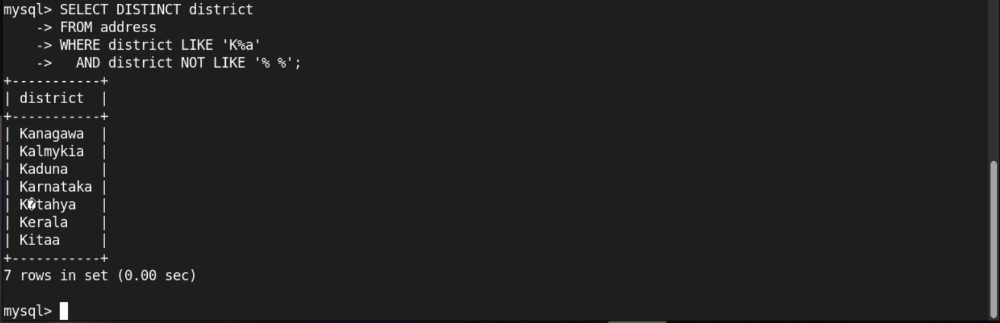
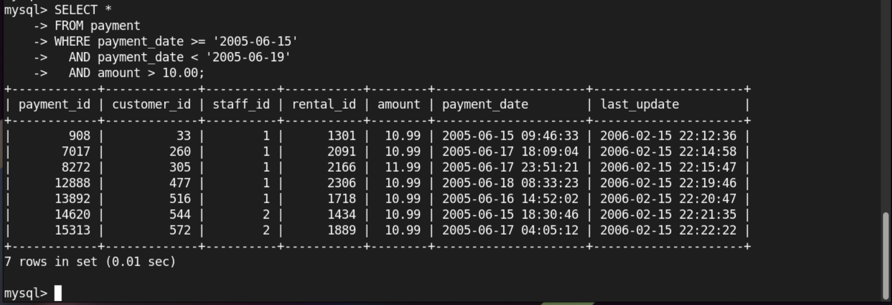
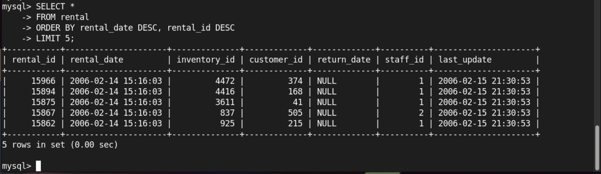
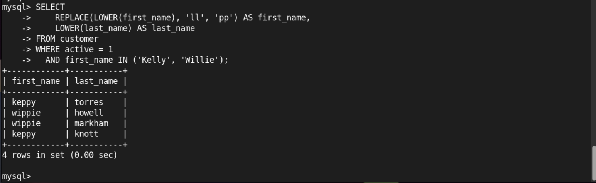

# Домашнее задание к занятию "`SQL. Часть 1`" - `Насибуллин Михаил`

---

### Задание 1

Получите уникальные названия районов из таблицы с адресами, которые начинаются на “K” и заканчиваются на “a” и не содержат пробелов.L 

### Ответ

---

### Задание 2

Получите из таблицы платежей за прокат фильмов информацию по платежам, которые выполнялись в промежуток с 15 июня 2005 года по 18 июня 2005 года включительно и стоимость которых превышает 10.00.L 

### Ответ

---

### Задание 3

Получите последние пять аренд фильмов.L 

### Ответ

---

### Задание 4

Одним запросом получите активных покупателей, имена которых Kelly или Willie.L 

Сформируйте вывод в результат таким образом:L 

все буквы в фамилии и имени из верхнего регистра переведите в нижний регистр,L 
замените буквы 'll' в именах на 'pp'.L 

### Ответ

